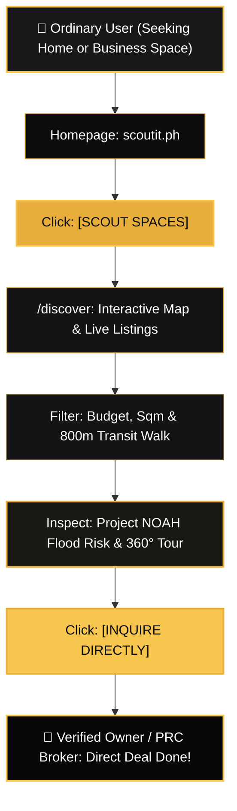

# 🧭 SCOUTIT BUTTON & FEATURE EXPLORATION GUIDE
**Answering: Where do buttons take me? What features exist? Why do everyday people care?**

---

## 1. Executive Summary: The User Experience Philosophy

Ordinary real estate websites are designed like traps:
- They hide addresses and coordinates.
- They force users to fill out lead forms before seeing basic details.
- They conceal flood risks, fault line proximity, and actual photos.
- They sell user phone numbers to unsolicited third-party brokers.

**ScoutIt flips this completely.** ScoutIt is built on sovereign transparency:
1. Every space has verified physical coordinates and dimensions.
2. Every button delivers immediate, unblocked utility.
3. Every environmental risk (floods, earthquakes, transit) is computed upfront.
4. Users communicate directly with verified space owners and licensed PRC brokers.

Below is the complete architectural map of every core button, destination URL, visual screenshot asset, and user outcome.

---

## 2. Interactive Button & Feature Matrix

| # | Button / UI Element | Visual Cutout Asset | Destination URL / State | What Happens When Clicked | Why Ordinary People & Businesses Care |
| :- | :--- | :--- | :--- | :--- | :--- |
| **01** | **`[SCOUT SPACES]`** | `btn_hero_scout_spaces.png` | `/discover` | Instantly launches the dual-pane interactive Mapbox GIS map, pinning active inventory across Metro Manila. | Zero paywalls or forms. Start exploring apartments, commercial studios, or offices in 1 click. |
| **02** | **`[SEARCH & FILTERS]`** | `btn_discover_search_and_filter.png` | Client-Side Dynamic Engine | Opens category pills (Residential, Office, Retail), price sliders (₱/sqm), and Haversine distance filters. | Filter to your exact monthly budget and find units within walking distance of work or MRT in under 5 seconds. |
| **03** | **`[MAP CLUSTER PINS]`** | `btn_interactive_map_cluster_pins.png` | `/property/[slug]` | Clicking any golden map pin triggers a smooth zoom and opens the full Property Architectural Dossier. | Visual location context: see exactly what building you are looking at in relation to BGC, Greenbelt, or MRT. |
| **04** | **`[PROJECT NOAH RADAR]`** | `btn_gis_transit_and_walk_radar.png` | Environmental Risk Envelope | Computes Project NOAH 100-year flood zone depth, elevation above sea level, and fault line distance. | **Life-saving intelligence:** Never rent a ground floor that floods knee-deep during monsoon typhoons. |
| **05** | **`[TECHNICAL SPECS]`** | `btn_property_technical_specs_grid.png` | Dossier Specs Module | Displays floor plate sqm, column-free layout, ceiling clearance (m), 100% backup generator power, and parking slots. | Transparent physical truth. No camera lens distortion or misleading square footage claims. |
| **06** | **`[360° SPATIAL TOUR]`** | `10_property_360_spatial_preview.png` | Panoramic Spatial Viewer | Loads a high-definition 360° interactive walkthrough of the space. | Tour the unit from your phone or laptop before wasting 3 hours traveling through Metro Manila traffic. |
| **07** | **`[VERIFIED BROKER]`** | `btn_verified_broker_credential.png` | Authenticated Identity Card | Displays the verified PRC Real Estate Broker License (`PRC REBL #0028491`) and agency credentials. | Avoid unregistered "fly-by-night" agents, scammers, and double-dipping middlemen. |
| **08** | **`[INQUIRE DIRECTLY]`** | `btn_direct_contact_inquire_dealroom.png` | Deal Room / Direct Contact | Opens direct encrypted WhatsApp, phone, or email connection to the verified space owner or broker. | No spam lists. No 5 middlemen adding commissions. Speak directly to the person who holds the keys. |
| **09** | **`[LIST YOUR SPACE]`** | Top Nav / Dashboard | `/dashboard` & Dual-CMS | Allows property owners to submit and publish their listing directly to Airtable & Supabase. | Space owners can list their unit with zero platform commission deductions. |

---

## 3. Step-by-Step User Journey: Everyday Relatability

---

## 4. Visual Assets in this Folder for Video Editors

1. **`card_01_button_scout_spaces_to_map.png`** (1920 × 1080)
   - Shows the exact homepage hero CTA, arrow transition, and live `/discover` map with verified BGC/Makati pins.
2. **`card_02_button_filters_and_pricing.png`** (1920 × 1080)
   - Demonstrates the budget, square meter, and transit walking radius filter engine.
3. **`card_03_button_hazard_and_flood_check.png`** (1920 × 1080)
   - Highlights the Project NOAH flood zone verification radar and elevation statistics.
4. **`card_04_button_direct_owner_inquiry.png`** (1920 × 1080)
   - Shows PRC-authenticated broker credentials and direct deal room communication.
5. **`card_05_visual_user_journey_infographic.png`** (1920 × 1080)
   - Master 5-step overview card suitable as an explainer slide or video chapter recap.
